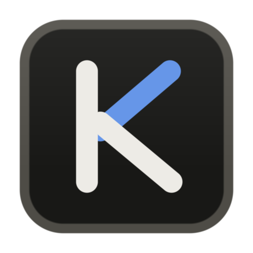

<div align="center">



# Krono

**Fast, local-first Markdown knowledge workspace written in Rust.**  
Notes, Kanban boards, custom tables, an infinite Canvas, a Knowledge Graph, a Vault Overview map, Diary Calendar, and private GitHub Sync — all stored as plain files you own.

<p>
  <a href="../../actions/workflows/ci.yml"></a>
  <a href="../../releases"></a>
  
  <a href="LICENSE"></a>
</p>

<p>
  <strong>English</strong> &nbsp;·&nbsp; <a href="README.ru.md">Русский</a>
</p>

</div>

---

## Why Krono?

Most knowledge tools force a choice between heavyweight Electron apps or proprietary cloud silos. **Krono** is a native OpenGL desktop app built in Rust (`eframe`/`egui` + SQLite FTS5) that starts instantly, keeps every note, board, and canvas as plain readable files on disk, and syncs privately through your own GitHub repository.

---

## Highlights

| Module | What you get |
| --- | --- |
| **Markdown Vault & Search** | Plain `.md` files with lossless YAML frontmatter (`title`, `status`, `tags`, `pinned`, `order`), instant FTS5 search, backlinks, automatic `[[wikilink]]` rewriting on rename, and safe soft-delete to `.trash/`. |
| **Interactive Editor** | **Edit / Split / Read** modes, cursor-anchored Slash (`/`) block menu, custom snippets, live `[[wikilink]]` autocomplete, inline task badges (`@YYYY-MM-DD`, `@today`, `!high`/`!med`/`!low`), and one-click copy/move of tasks to any Kanban board. |
| **Kanban Boards & Tables** | Built-in Task Board with smooth drag-and-drop reordering and FLIP animations, plus custom `.board.json` / `.table.json` collections with custom fields (`Select`, `Date`, `Checkbox`, `Number`, `NoteLink`), smart filters, and persistent **Saved Views**. |
| **Infinite Canvas** | Spatial `.canvas` boards with text cards, linked files, groups, clipboard image paste (`Ctrl/Cmd+V`), styled labeled arrows, `Ctrl+F` search, Marquee multi-select (`Shift+Drag` or `V`), Smart Alignment Guides, mini-map, undo/redo, and linear `.md` export. |
| **Graph & Vault Overview** | Force-directed global & local **Knowledge Graph**, plus a spatial **Vault Overview** (`Обзор`) grouping folders and cross-folder links into draggable clusters. |
| **Diary & Asset Audit** | Automatic `daily/YYYY/MM/` diary hierarchy & `daily/boards/YYYY/MM/` task boards, monthly calendar & streak counter, and an **Attachments Archive** (`assets/`) scanner to inspect and clean unused images. |
| **Navigation & Polish** | Browser-style `Back` / `Forward` (`Alt+←` / `Alt+→`), quick recent tabs bar, 6 curated dark & light themes (`Graphite`, `Paper`, `Obsidian OLED`, `Editorial Sand`, `Warm Espresso`, `Everforest`), and full **EN / RU** localization. |
| **Private GitHub Sync** | Direct Git Data API 3-way merge with LF normalization before SHA-1 hashing, SQLite `blob_sha` tracking, case-collision protection, and non-destructive external conflict resolution. |

---

## Downloads & Installation

Pre-built beta packages are available on the **[GitHub Releases](../../releases)** page:

| Platform | Package | How to install |
| --- | --- | --- |
| **Windows (x86_64)** | `krono-<tag>-windows-x86_64.zip` | Extract the archive and run `krono-desktop.exe`. |
| **macOS (Apple Silicon — M1–M4)** | `krono-<tag>-macos-arm64.dmg` | Open the `.dmg` and drag **Krono.app** to **Applications**. |
| **macOS (Intel, 10.13+)** | `krono-<tag>-macos-x86_64.dmg` | Open the `.dmg` and drag **Krono.app** to **Applications**. |
| **Linux (x86_64)** | `krono-<tag>-linux-x86_64.tar.gz` | Extract and run `./install.sh` (or launch `./krono-desktop` directly). |

> **macOS Beta Note:** Beta builds use ad-hoc signing (`codesign -s -`). If macOS Gatekeeper blocks the first launch, run once in Terminal:
> ```sh
> xattr -cr /Applications/Krono.app
> ```

> **Linux Runtime Note:** Make sure standard graphics/windowing runtime libraries (`libxkbcommon`, `mesa`/`libGL`, `wayland` or `libX11`) are installed on your distribution.

---

## Keyboard Shortcuts

| Action | Windows / Linux | macOS |
| --- | --- | --- |
| Command Palette | `Ctrl+K` | `Cmd+K` |
| Create New Item | `Ctrl+N` | `Cmd+N` |
| Today's Daily Note | `Ctrl+D` | `Cmd+D` |
| Back / Forward | `Alt+←` / `Alt+→` | `Option+←` / `Option+→` |
| Save Active Document | `Ctrl+S` | `Cmd+S` |
| Sync with GitHub | `Ctrl+Shift+S` | `Cmd+Shift+S` |
| Knowledge Graph | `Ctrl+G` | `Cmd+G` |
| Canvas Marquee Select | `V` or `Shift+Drag` | `V` or `Shift+Drag` |
| Toggle Sidebar | `Ctrl+\` | `Cmd+\` |
| Toggle Inspector | `Ctrl+Shift+I` | `Cmd+Shift+I` |
| Settings | `Ctrl+,` | `Cmd+,` |

---

## Build From Source

Requires [Rust (`stable`)](https://rustup.rs/).

### Windows / macOS
```sh
cargo test --workspace --locked
cargo build --release --locked -p krono-desktop
```

### Linux (Ubuntu / Debian)
```sh
sudo apt-get install -y pkg-config libxkbcommon-dev libwayland-dev libx11-dev \
  libxi-dev libxcursor-dev libxrandr-dev libxinerama-dev libgl1-mesa-dev libegl1-mesa-dev
cargo test --workspace --locked
cargo build --release --locked -p krono-desktop
```

### Cross-Compile macOS Intel on Apple Silicon
```sh
rustup target add x86_64-apple-darwin
MACOSX_DEPLOYMENT_TARGET=10.13 cargo build --release --locked --target x86_64-apple-darwin -p krono-desktop
```

---

## Automated Releases (CI/CD)

Workflows in [.github/workflows](.github/workflows):
- **`ci.yml`** — runs tests and release builds on every push/PR across Windows, Linux, macOS Apple Silicon, and macOS Intel.
- **`release.yml`** — builds and publishes `.zip`, `.tar.gz`, `.dmg` (`arm64` & `x86_64`), and `SHA256SUMS.txt` automatically on version tags:

```sh
git tag v0.2.0-beta.1
git push origin v0.2.0-beta.1
```

---

## License

Released under the [MIT License](LICENSE).
