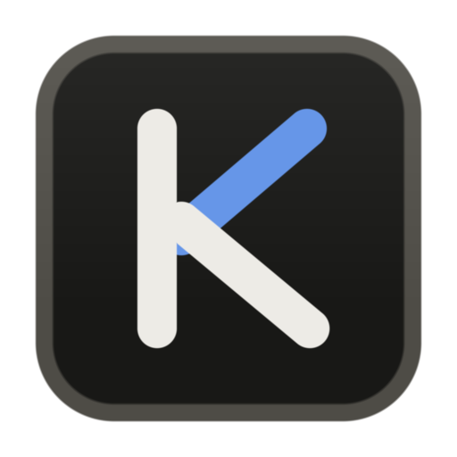

<div align="center">



# Krono

**Быстрое локальное рабочее пространство для заметок и знаний на Rust.**  
Заметки в Markdown, канбан-доски, кастомные таблицы, бесконечный Canvas, граф связей, карта хранилища, календарь-дневник и приватная синхронизация с GitHub — всё хранится в обычных файлах у вас на диске.

<p>
  <a href="../../actions/workflows/ci.yml"></a>
  <a href="../../releases"></a>
  
  <a href="LICENSE"></a>
</p>

<p>
  <a href="README.md">English</a> &nbsp;·&nbsp; <strong>Русский</strong>
</p>

</div>

---

## Почему Krono?

Большинство приложений для заметок либо тяжеловесные (Electron), либо привязывают ваши данные к закрытому облаку. **Krono** — это нативное OpenGL-приложение на Rust (`eframe`/`egui` + SQLite FTS5): мгновенный запуск, минимальное потребление памяти, открытые файлы `.md` / `.json` / `.canvas` на диске и опциональная синхронизация через ваш приватный репозиторий GitHub.

---

## Основные возможности

| Раздел | Что внутри |
| --- | --- |
| **Markdown-хранилище и поиск** | Обычные `.md` файлы с YAML frontmatter (`title`, `status`, `tags`, `pinned`, `order`), мгновенный полнотекстовый поиск SQLite FTS5, обратные ссылки, автообновление `[[wikilinks]]` при переименовании и безопасное удаление в `.trash/`. |
| **Умный редактор** | Режимы **Редактор / Сплит / Чтение**, слеш-меню (`/`) с блоками и пользовательскими сниппетами, автодополнение `[[ссылок]]`, бейджи сроков и приоритета у задач (`@YYYY-MM-DD`, `@today`, `!high`/`!med`/`!low`) и отправка задач прямо на любую канбан-доску. |
| **Канбан-доски и таблицы** | Встроенная «Доска задач» с плавным перетаскиванием и FLIP-анимациями, а также кастомные `.board.json` / `.table.json` с произвольными полями (`Select`, `Date`, `Checkbox`, `Number`, `NoteLink`), умными фильтрами и **сохранёнными видами**. |
| **Бесконечный Canvas** | Пространственные холсты `.canvas`: карточки, привязанные заметки, группы, вставка картинок из буфера (`Ctrl/Cmd+V`), подписанные стрелки, поиск `Ctrl+F`, мульти-выделение рамкой (`Shift+Drag` или `V`), Smart-направляющие выравнивания, мини-карта, Undo/Redo и экспорт в `.md`. |
| **Граф и карта хранилища** | Глобальный и локальный **Граф связей**, а также вкладка **Обзор** — интерактивная карта всех папок хранилища с карточками и связями. |
| **Дневник и архив вложений** | Иерархия дневника (`daily/YYYY/MM/`) и дневниковых досок (`daily/boards/YYYY/MM/`), виджет календаря со стриком, плюс **Архив вложений (`assets/`)** для поиска и очистки неиспользуемых изображений. |
| **Навигация и оформление** | История переходов `Назад` / `Вперёд` (`Alt+←` / `Alt+→`), панель быстрых вкладок, 6 проработанных тем (`Graphite`, `Paper`, `Obsidian OLED`, `Editorial Sand`, `Warm Espresso`, `Everforest`) и интерфейс на **русском / английском**. |
| **Синхронизация через GitHub** | Прямой 3-way merge через Git Data API (без локального git и серверов), нормализация LF, трекинг `blob_sha` в SQLite и защита от потери внешних изменений. |

---

## Скачивание и установка

Готовые сборки бета-версии доступны на странице **[GitHub Releases](../../releases)**:

| Система | Архив / образ | Установка |
| --- | --- | --- |
| **Windows (x86_64)** | `krono-<tag>-windows-x86_64.zip` | Распакуйте архив и запустите `krono-desktop.exe`. |
| **macOS (Apple Silicon — M1–M4)** | `krono-<tag>-macos-arm64.dmg` | Откройте `.dmg` и перетащите **Krono.app** в **Программы (Applications)**. |
| **macOS (Intel)** | `krono-<tag>-macos-x86_64.dmg` | Откройте `.dmg` и перетащите **Krono.app** в **Программы (Applications)**. |
| **Linux (x86_64)** | `krono-<tag>-linux-x86_64.tar.gz` | Распакуйте и выполните `./install.sh` (или запускайте `./krono-desktop` напрямую). |

> **Заметка для macOS (бета):** бета-сборки подписаны локальной ad-hoc подписью (`codesign -s -`). Если macOS Gatekeeper заблокирует первый запуск, выполните один раз в Терминале:
> ```sh
> xattr -cr /Applications/Krono.app
> ```

> **Заметка для Linux:** убедитесь, что в системе установлены базовые runtime-библиотеки (`libxkbcommon`, `mesa`/`libGL`, `wayland` или `libX11`).

---

## Горячие клавиши

| Действие | Windows / Linux | macOS |
| --- | --- | --- |
| Палитра команд | `Ctrl+K` | `Cmd+K` |
| Создать элемент | `Ctrl+N` | `Cmd+N` |
| Заметка на сегодня | `Ctrl+D` | `Cmd+D` |
| Назад / Вперёд | `Alt+←` / `Alt+→` | `Option+←` / `Option+→` |
| Сохранить документ | `Ctrl+S` | `Cmd+S` |
| Синхронизация с GitHub | `Ctrl+Shift+S` | `Cmd+Shift+S` |
| Граф связей | `Ctrl+G` | `Cmd+G` |
| Рамка выделения в Canvas | `V` или `Shift+Drag` | `V` или `Shift+Drag` |
| Показать / скрыть сайдбар | `Ctrl+\` | `Cmd+\` |
| Показать / скрыть инспектор | `Ctrl+Shift+I` | `Cmd+Shift+I` |
| Настройки | `Ctrl+,` | `Cmd+,` |

---

## Сборка из исходников

Требуется установленный [Rust (`stable`)](https://rustup.rs/).

### Windows / macOS
```sh
cargo test --workspace --locked
cargo build --release --locked -p krono-desktop
```

### Linux (Ubuntu / Debian)
```sh
sudo apt-get install -y pkg-config libxkbcommon-dev libwayland-dev libx11-dev \
  libxi-dev libxcursor-dev libxrandr-dev libxinerama-dev libgl1-mesa-dev libegl1-mesa-dev
cargo test --workspace --locked
cargo build --release --locked -p krono-desktop
```

### Кросс-сборка macOS Intel на Apple Silicon
```sh
rustup target add x86_64-apple-darwin
MACOSX_DEPLOYMENT_TARGET=10.15 cargo build --release --locked --target x86_64-apple-darwin -p krono-desktop
```

---

## Автоматическая сборка релизов (CI/CD)

Workflow-файлы лежат в [.github/workflows](.github/workflows):
- **`ci.yml`** — проверяет тесты и релизную сборку при каждом пуше и PR на Windows, Linux, macOS Apple Silicon и macOS Intel.
- **`release.yml`** — при пуше тега `v*` автоматически собирает `.zip`, `.tar.gz`, `.dmg` (`arm64` и `x86_64`) + `SHA256SUMS.txt` и публикует GitHub Release:

```sh
git tag v0.2.0-beta.1
git push origin v0.2.0-beta.1
```

---

## Лицензия

Проект распространяется под лицензией [MIT](LICENSE).
